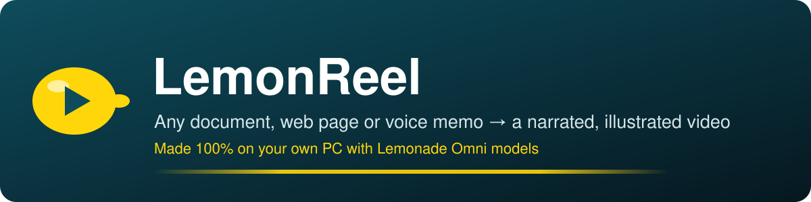
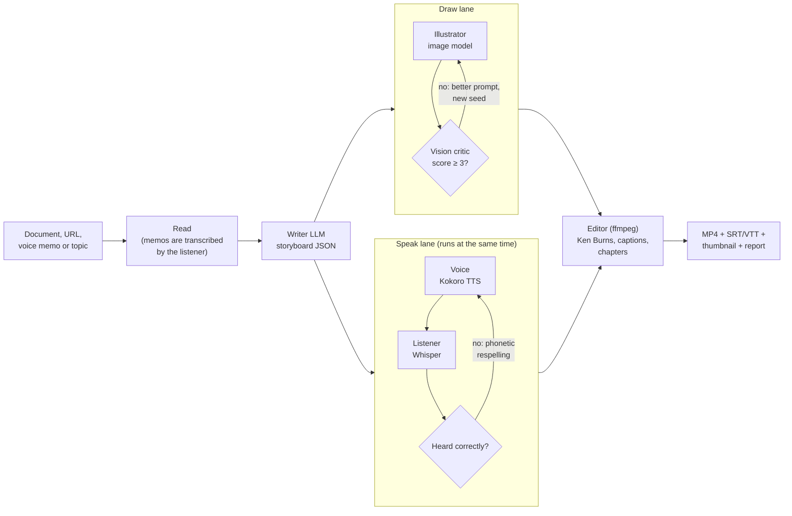

<p align="center">
  
</p>

<p align="center">
  <a href="LICENSE"></a>
  
  
  
</p>

**LemonReel** turns a README, release notes, a lesson, a PDF, a web page or a rambling voice memo into a
finished explainer video: a script, an illustration for every scene, narration (one narrator or a
two-host "podcast"), timed captions, chapters and a thumbnail. Everything is generated by a single
[Lemonade](https://lemonade-server.ai) **Omni model** running on your own PC. No API keys, no uploads,
no per-minute bill.

Cloud tools like NotebookLM's video overviews made this kind of thing popular, but they need your
documents on someone else's servers. LemonReel does it locally, and it checks its own work while it
goes:

- **It looks at its pictures.** The Omni model's vision LLM grades every illustration against the
  scene it was meant to show and asks for a redraw when it misses.
- **It listens to its own voice.** Every narrated line is transcribed again by the Omni model's
  speech recognizer. Names and jargon the voice mangled ("ROCm", "Strix", "Qwen") are respelled
  phonetically and re-spoken, and LemonReel remembers the fix for every future video.
- **Its captions are timed to what was actually said**, by aligning the script with the recognizer's
  word timestamps.

```bash
lemonreel make https://github.com/lemonade-sdk/lemonade      # a 90-second explainer of a repo
lemonreel make notes.m4a --mode duo --aspect 9:16            # voice memo -> two-host vertical short
lemonreel studio                                             # or do it all in the browser
```

> **Demo Video:** Watch the 90-second walkthrough on YouTube: [https://youtu.be/YOUR_LINK](https://youtu.be/YOUR_LINK)
---

## Contents

- [What you get](#what-you-get)
- [Quick start](#quick-start)
- [Using the Studio](#using-the-studio)
- [Command line cookbook](#command-line-cookbook)
- [Narrate your own videos](#narrate-your-own-videos)
- [How it works](#how-it-works)
- [How LemonReel uses Lemonade](#how-lemonreel-uses-lemonade)
- [Choosing an Omni model for your hardware](#choosing-an-omni-model-for-your-hardware)
- [The run report](#the-run-report)
- [Options](#options)
- [Python API](#python-api)
- [Development](#development)
- [Roadmap](#roadmap)
- [Deep dive: docs/how-it-works.md](docs/how-it-works.md)
- [Troubleshooting: docs/troubleshooting.md](docs/troubleshooting.md)

## What you get

Every run writes a folder like `reels/release-notes-20261020-1412/` containing:

| File | What it is |
|------|------------|
| `<title>.mp4` | H.264/AAC video with a title card, one scene per illustration with a slow Ken Burns move, a headline badge, burned-in captions and a closing credits card. Chapters are embedded. |
| `captions.srt`, `captions.vtt` | Subtitles timed from the listen-back transcript, ready for YouTube or a `<track>` element. |
| `chapters.txt` | Chapter list in the format YouTube picks up from a video description. |
| `thumbnail.jpg` | A 1280x720 title card for the video page. |
| `storyboard.json` | The script. Edit it and run `lemonreel remake <folder>`; only changed scenes are regenerated. |
| `report.html`, `report.json` | What ran where and for how long, every self-check, and every pronunciation fix. |
| `scenes/NN/` | Each scene's picture attempts, narration takes and transcripts. |

Supported inputs: Markdown, text, reStructuredText, HTML, PDF (`pip install "lemonreel[pdf]"`), any web
page, GitHub repository URLs (the README is used), audio files in any common format, or just a topic in
quotes. Output languages: English (US/UK), Spanish, French, Hindi, Italian, Japanese, Portuguese and
Mandarin, in 16:9, 9:16 or 1:1.

## Quick start

**1. Install Lemonade and an Omni model.** Get Lemonade Server for Windows, Linux or macOS from
[lemonade-server.ai](https://lemonade-server.ai), start it, then download an Omni model:

```bash
lemonade pull LMX-Omni-5.5B-Lite      # ~9 GB: Qwen3.5-4B + SD-Turbo + Whisper-Tiny + Kokoro
```

**2. Install LemonReel** (Python 3.10 or newer; ffmpeg is bundled, nothing else to install):

```bash
pip install "git+https://github.com/Amirtheshwaran/lemonreel"
# or, from a clone:
git clone https://github.com/Amirtheshwaran/lemonreel && cd lemonreel && pip install -e .
```

**3. Check the setup.** `doctor` finds the server, lists Omni models, shows which model fills each
role, and with `--smoke` times one small request per model:

```bash
lemonreel doctor --smoke
```

**4. Make a video.**

```bash
lemonreel make README.md --open
```

The finished MP4 and its report open in your browser. If Lemonade isn't running, or no Omni model is
downloaded, LemonReel says exactly which command fixes it. More fixes are in
[docs/troubleshooting.md](docs/troubleshooting.md).

## Using the Studio

```bash
lemonreel studio          # opens http://localhost:8765
```

The Studio is a local web app for people who'd rather not use a terminal. Paste text, give it a URL,
drop a file, **record a voice memo in the browser**, or type a topic. Pick the number of scenes, length,
narrator or two hosts, shape, language and look, and press **Make my reel**. You can watch the run as it
happens:

- the storyboard appears as soon as the writer finishes it,
- each scene card fills in with its picture and the critic's score (and how many redraws it took),
- each card gets its narration, the listen-back error rate, and any word that had to be respelled,
- the final video plays in the page with download links for the MP4, captions and the run report.

Past reels are listed at the bottom. The Studio only listens on `127.0.0.1` by default.

## Command line cookbook

```bash
# A repository's README as a 2-minute explainer, in the "3d" look
lemonreel make https://github.com/lemonade-sdk/lemonade --minutes 2 --look 3d

# Release notes as a vertical short with two hosts
lemonreel make CHANGELOG.md --mode duo --aspect 9:16 --scenes 5 --minutes 1

# The same lesson for Spanish-speaking students (source can stay in English)
lemonreel make lesson.md --language es

# Think out loud, get a video: transcribed by the Omni model's listener first
lemonreel make idea.m4a

# No document at all
lemonreel make "How an NPU speeds up local AI" --audience "high-school students"

# Review the script before anything is drawn or spoken
lemonreel make paper.pdf --storyboard-only
#   ...edit reels/paper-.../storyboard.json...
lemonreel remake reels/paper-20261020-1412

# Use the big Omni model, or your own custom one
lemonreel make talk.md --omni LMX-Omni-52B-Halo
lemonreel make talk.md --omni user.MyOmni

# Mix and match roles yourself
lemonreel make talk.md --writer Gemma-4-E2B-it-GGUF --listener Whisper-Large-v3-Turbo
```

## Narrate your own videos

`lemonreel say` gives any script the same local voice and pronunciation checks, for videos you
edit yourself, such as a screen recording or a product demo:

```bash
lemonreel say examples/voiceover-script.md --voice af_heart
```

Blank lines and `# headings` separate parts. Headings, `[stage directions]` and lines that are only a
link or a `---` rule are not read aloud, so one file can be both your teleprompter and the narration.
Markdown emphasis is removed, while names like `snake_case` are kept. Each part is spoken by the Omni
model's voice, transcribed by its listener, and re-spoken with phonetic respellings if a name came
out wrong (that step uses the writer LLM when there is one; `say` also works with only a voice
model). You can pass the text itself in quotes instead of a file; an argument that looks like a
file name but doesn't exist is reported as missing rather than read out. The output folder
(`<script>-voiceover/` next to the script, or `--out`) contains:

| File | What it is |
|------|------------|
| `voiceover.wav` | The whole narration, parts separated by `--pause` seconds (default 0.7) |
| `part-NN.wav` | One file per part, to drop under the matching clip in a video editor |
| `voiceover.srt` | Captions timed from the listener's word timestamps |
| `timing.txt` | Where each part starts and how long it runs |
| `takes/` | Every take and the 16 kHz copies sent to the listener; safe to delete |

Running `say` again into the same folder replaces the previous run's files.

## How it works



1. **Read.** The source becomes plain text. Long sources are first condensed to key points so they fit
   the writer's context window.
2. **Write.** The writer LLM produces a storyboard as JSON: a title and, per scene, an on-screen
   headline, the spoken words (or a host A/B dialogue) and an image prompt. Replies are parsed
   defensively (code fences, stray reasoning, trailing commas); if a reply still can't be used, the
   parse error is sent back and the model fixes its own output.
3. **Draw and speak, in parallel.** Lemonade keeps one model of each type loaded at once, so the
   image model and the speech models work side by side. On a Ryzen AI PC the illustrator can be busy
   on the GPU while Kokoro speaks on the CPU and, on Windows, Whisper listens on the NPU.
   - **Vision critique:** each picture is shown back to the writer (when it has the `vision` label)
     with the intended scene. A score below 3 out of 5 triggers a redraw with the critic's improved
     prompt and a new seed; the best attempt wins.
   - **Listen-back:** each clip is transcribed and compared with the script. If the word error rate is
     high, or *any* name or acronym was misheard, the writer proposes phonetic respellings, the clip
     is spoken again, and the better take is kept. Successful respellings go into
     `~/.lemonreel/lexicon.json`, so the next video gets them right the first time. Captions always
     show the original spelling.
4. **Edit.** ffmpeg builds each scene: a 2x-resolution still with an eased zoom or pan, the headline
   badge fading in and out, and caption overlays whose timing comes from aligning the script with the
   recognizer's word timestamps. Segments are joined without re-encoding, then chapters and an
   optional soft-subtitle track are added.
5. **Report.** Timings of every request, the devices each model ran on, critic scores, error rates
   and pronunciation fixes go into `report.html` and `report.json`.

The [deep dive](docs/how-it-works.md) covers each step, including the alignment math and the
heuristics that decide which misheard words are worth fixing.

## How LemonReel uses Lemonade

LemonReel talks to Lemonade over its OpenAI-compatible and Lemonade-specific HTTP API. It needs no
Lemonade-specific client library.

| Endpoint | Role | Used for |
|----------|------|----------|
| `GET /v1/health`, `GET /v1/system-info` | | Server version, CPU/GPU/NPU details, and which device and backend each loaded model is on (shown in the report) |
| `GET /v1/models?show_all=true` | | Finding Omni collections (`recipe: "collection.omni"`), their `components`, and each component's `labels` and `image_defaults` |
| `POST /v1/chat/completions` | Writer | Storyboard (`response_format: json_object`, thinking disabled via `chat_template_kwargs`), condensing long sources, phonetic respellings |
| `POST /v1/chat/completions` with `image_url` | Vision critic | Scoring each picture against its scene |
| `POST /v1/images/generations` | Illustrator | Scene pictures at a size derived from the model's `image_defaults` and `soft_pixel_cap`, in the video's aspect ratio |
| `POST /v1/images/upscale` | Upscaler (optional) | Sharper frames with a downloaded Real-ESRGAN model (`--upscale`) |
| `POST /v1/audio/speech` | Voice | Narration with Kokoro voices, WAV output |
| `POST /v1/audio/transcriptions` | Listener | Listen-back checks (`verbose_json` word timestamps for captions) and voice-memo input |
| `GET /v1/stats` | | The writer's tokens per second and time to first token |

Roles come from the Omni model's components and their labels, so LemonReel works with the shipped
Omni models, with any custom Omni model you build in the Lemonade app, or with loose models when you
have no Omni model at all. Missing pieces degrade gracefully: with no image model you get typographic
slides, with no recognizer the captions are spread evenly and listen-back is skipped, and with no
vision label pictures are not graded.

## Choosing an Omni model for your hardware

| Your PC | Suggested model | Notes |
|---------|-----------------|-------|
| Any recent laptop or desktop, 16-32 GB RAM | `LMX-Omni-5.5B-Lite` | Works on CPU alone, but each picture can take minutes; a Radeon iGPU or dGPU (Vulkan or ROCm) is far faster. |
| Ryzen AI 300 series | `LMX-Omni-5.5B-Lite` | On Windows, Lemonade can run Whisper on the NPU, leaving the GPU to the image model. |
| Ryzen AI Max (Strix Halo), 64-128 GB | `LMX-Omni-52B-Halo` | Qwen3.6-35B-A3B writer, Flux-2-Klein-9B pictures, Whisper-Large-v3-Turbo listener. |

Pass `--omni` to choose. Without it LemonReel picks a downloaded Omni model, preferring Halo, then
Lite. `lemonreel doctor --smoke` shows how long one request per model takes on your machine, which is
the quickest way to decide.

## The run report

`report.html` opens next to the video and contains:

- **Hardware and models:** the processor, GPUs and NPU Lemonade reported; which model filled each
  role; the device and backend it ran on (for example `gpu / vulkan`); and how long it was busy.
- **Who was busy when:** a timeline of every request on four rows (writer, illustrator, voice,
  listener). Overlapping bars are engines that ran at the same time on different devices.
- **Scenes:** each picture with its critic score and redraw count, the narration, the listen-back
  error rate before and after fixes, and the respellings that were used.
- **Pronunciation fixes learned** during the run.

`report.json` has the same data plus the raw request trace, for anyone who wants to compare hardware
or Lemonade versions.

## Options

`lemonreel make --help` lists everything. The main options:

| Option | Default | Meaning |
|--------|---------|---------|
| `--scenes N` | 6 | Number of scenes |
| `--minutes M` | 1.5 | Target length; sets the words per scene |
| `--mode narrator\|duo` | narrator | One narrator or a two-host conversation |
| `--language` | en | `en`, `en-gb`, `es`, `fr`, `hi`, `it`, `ja`, `pt`, `zh` |
| `--look` | illustration | `illustration`, `photo`, `watercolor`, `3d`, `comic`, `blueprint`, `pixel`, or any description |
| `--voice`, `--voice2` | per language | Kokoro voices (`lemonreel voices` lists them) |
| `--aspect 16:9\|9:16\|1:1` | 16:9 | YouTube, Shorts/Reels/TikTok, or square |
| `--hd` | off | 1080p instead of 720p |
| `--captions burn\|soft\|both\|none` | burn | Burn captions in, add a subtitle track, both, or neither |
| `--omni`, `--writer`, `--illustrator`, `--voice-model`, `--listener` | auto | Choose models |
| `--no-critique`, `--min-score`, `--max-redraws` | on, 3, 2 | Vision critique settings |
| `--no-listen-back`, `--no-learn`, `--lexicon FILE` | on, on, - | Listen-back settings and extra pronunciations |
| `--storyboard-only` | off | Stop after the script so you can edit it |
| `--sequential` | off | Draw and speak one after the other |
| `--base-url` | auto | Lemonade address; also `LEMONADE_BASE_URL`. Ports 13305 and 8000 are tried automatically. |

`LEMONADE_API_KEY` is sent as a bearer token when set, matching Lemonade's own setting.

## Python API

```python
from lemonreel.config import ReelConfig
from lemonreel.pipeline import Reel

reel = Reel(ReelConfig(scenes=5, minutes=1, mode="duo", aspect="9:16"))
result = reel.run("docs/announcement.md")
print(result.video, result.timeline.duration, result.report_html)
```

`Reel(..., on_event=callback)` receives every progress event (stage changes, each picture, each
narrated scene), which is how the Studio streams progress. `Reel(..., cancel=threading.Event())`
lets you stop a run.

## Development

```bash
git clone https://github.com/Amirtheshwaran/lemonreel && cd lemonreel
pip install -e ".[dev]"
ruff check src tests && pytest
```

The test suite needs no GPU and no models. `tests/fake_lemonade.py` is a stand-in Lemonade server
that follows the request and response shapes in Lemonade's API documentation: it lists an Omni
collection with embedded components, returns `verbose_json` transcripts with word timestamps, and
synthesizes speech as tone bursts that its recognizer can identify again after resampling. It also
mispronounces "Strix" and rejects one picture, so the end-to-end tests exercise both self-check loops
and produce real MP4 files. CI runs the suite on Windows, macOS and Linux.

You can also point the Studio at it to work on the UI without models:

```bash
python tests/fake_lemonade.py --port 13399 &
lemonreel studio --base-url http://127.0.0.1:13399
```

Project layout:

```
src/lemonreel/
  lemonade.py     HTTP client with request tracing
  omni.py         Omni collection -> roles
  ingest.py       files, URLs, GitHub READMEs, PDFs, voice memos
  storyboard.py   writer prompt, JSON validation and self-repair
  visuals.py      image generation and vision critique
  voice.py        narration, listen-back and respelling
  lexicon.py      pronunciation lexicon (built-in, learned, user)
  textmetrics.py  normalization, word error rate, mismatch finding
  captions.py     word-timestamp alignment, SRT/VTT
  graphics.py     captions, badges, title and credits cards
  render.py       ffmpeg segments, chapters, soft subtitles
  report.py       report.json and report.html
  pipeline.py     the whole run, with parallel draw and speak lanes
  say.py          voiceovers for your own videos (lemonreel say)
  studio/         local web app (FastAPI + one static page)
```

See [CONTRIBUTING.md](CONTRIBUTING.md) for how to propose changes.

## Roadmap

- Keep characters consistent across scenes with Omni models that have an `edit` image model.
- Background music from Lemonade's audio-generation models, ducked under the narration.
- Speaker voices designed or cloned with OpenMOSS models.
- An MCP tool so agents can ask for a video.
- Batch mode for a folder of documents, such as a whole course or every release.

## License

[MIT](LICENSE). LemonReel calls models through Lemonade; each model keeps its own license.

Built on [Lemonade](https://github.com/lemonade-sdk/lemonade) and the open models and engines it
serves: llama.cpp, stable-diffusion.cpp, whisper.cpp and Kokoro.
